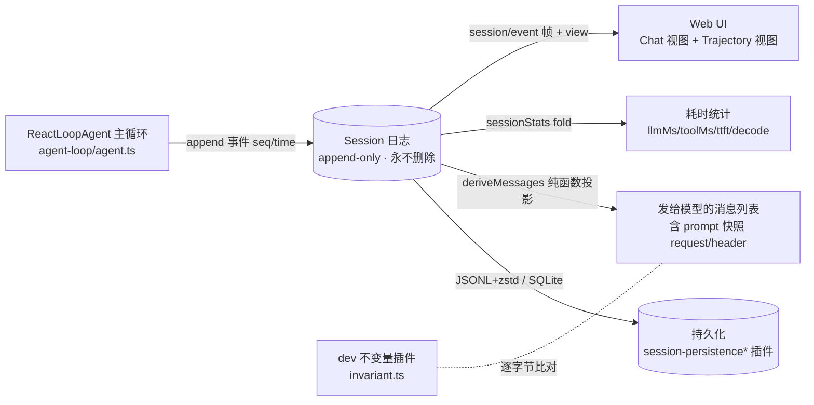
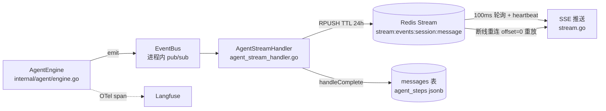

# Agent 轨迹可视化与可观测性调研：DeepSeek Harness 与 WeKnora

- 日期：2026-11-12
- 调研对象：
  - **DeepSeek Harness（dsh）**：本地克隆 `D:\AI\deepseek-harness`，master 分支，commit `b150a551b8`（2026-08-21）。TypeScript pnpm monorepo，everything-is-a-plugin 架构。
  - **WeKnora**：本地克隆 `D:\AI\WeKnora-feat_MCP`，main 分支，commit `9379fa7f1`（2026-11-02），v0.9.0。Go 后端 + Vue 前端，RAG / Agent / Wiki 三合一知识框架（腾讯开源）。
- 调研途径：代码级逐文件调研，所有结论附文件路径与行号（相对各自仓库根目录）。
- 本报告定位：事实调研（第 1、2 章）＋需求能力矩阵（第 3 章）＋可借鉴机制优先级建议（第 4 章）；事件全表、埋点清单等长清单收录在附录。

## 0. 我们的需求清单（矩阵维度来源）

来自平台建设的原始需求，归纳为 12 条判定维度：

| # | 维度 | 原始诉求 |
|---|------|---------|
| D1 | 轨迹可视化 | agent 对话全流程有专门的 trace/timeline 视图可看 |
| D2 | 轨迹可回放 | 会话结束后（刷新/重启/崩溃后）能从持久化数据重建完整轨迹 |
| D3 | 日志审计地基 | 记录不可变、可从日志重建模型可见内容（审计的完整性前提） |
| D4 | prompt 动态替换 | prompt 可运行时替换、按请求生效，无需改代码 |
| D5 | prompt 版本管理 | prompt 有版本概念：历史可查、每次请求用了哪版可追溯 |
| D6 | 工具调用审计 | 每次工具调用的入参、结果、耗时、审批决定可查 |
| D7 | 模型调用审计 | 每次 LLM 调用的完整请求/响应/token 用量可查 |
| D8 | 输入侧环节 | 用户输入的接收、预处理、改写（意图识别等）进入轨迹 |
| D9 | ReAct 循环内部 | 每轮思考、模型输出 token 流、循环边界可见 |
| D10 | 总结输出环节 | 最终答案的合成、截断、撤回、降级过程可见 |
| D11 | 耗时与错误分析 | 每步耗时可量化、可排序；错误有统一形态且进轨迹 |
| D12 | 敏感词/内容审核 | 输入输出经过审核环节，审核决定进轨迹 |

## 1. DeepSeek Harness（dsh）

### 1.1 会话日志：append-only 事件溯源 + 纯函数投影

dsh 的可观测性地基是一句话：**会话是一个 append-only 事件日志，消息历史是日志的投影**。




- `Session` 定义自述为 "merge-extensible, append-only source of truth for an agent interaction. Message history is derived from this log."（`packages/core/session/src/types.ts:230-235`）。
- 事件信封按 `type` 判别，每条事件带 `seq`（会话内单调递增）与 `time`（epoch ms）（`types.ts:408-440`）。append 时 `seq` 取 `log.length`，seed 校验强制 seq 从 0 连续（`packages/core/session/src/index.ts:525-527, 627-633`）。
- 事件词汇 `SessionEventMap` 含 17 个核心类型（`types.ts:236-337`）：`turn/start|end`、`step/start|end`、`user/message`、`assistant/chunk`（token 级原始 chunk）、`assistant/message`（带 `TokenUsage`、`interrupted` 标记）、`tool/call`、`tool/result`、`todo/write`、`request/header`、`request/context`、`session/end-seed`。全仓库已知事件类型共 49 个（由脚本生成的 `packages/core/session/src/known-event-types.ts:19-68`，完整清单见附录 A）。
- 事件词汇可被插件以 declaration-merge 扩展（例：`packages/llm/llm-retry/src/types.ts:6-13` 合并 `llm/retry` 事件；`packages/subagent/subagent/src/descriptor.ts:28-39` 合并 `subagent/descriptor`）。未知类型默认拒绝重建，除非带 `ignorable: true`（`types.ts:416-426`）——冷读旧日志时新插件词汇缺失会 fail-fast。

**投影（deriveMessages）**：

- `Session.deriveMessages()` 沿 `surfaceOp` 标记维护的有序 surface 遍历，逐节点调用纯函数 `deriveEventMessage`（`packages/core/session/src/index.ts:726-747`；`packages/core/session/src/surface.ts:83-114`）。`user/message`→user 消息、`assistant/message`→assistant 消息、`tool/result`→user 角色工具结果消息；chunk/边界类事件投影为 null。该函数被导出，外部重建器与开发期不变量用同一套规则投影（`docs/subsystems/session.md:527`）。
- `foldSurface(events)` 提供纯离线折叠（`surface.ts:387-395`）；`SurfaceManager` 是活会话的增量实现，并在每个 append 时验证 surface 合法性（replace 范围存在、`sourceEventSeqs` 覆盖全部被遮蔽节点，`surface.ts:210-266`）——压缩（compaction）替换历史时遮蔽关系也是日志的一部分。
- 另有通用投影框架 `ctx.sessionProjections`：领域插件注册纯 fold，框架对每个已提交事件 eager drive，支持 host 端 checkpoint 持久缓存（`packages/session/session-projection/src/index.ts:180-495`）。

**持久化（插件化，两个后端）**：

- JSONL 后端（默认）：目录 `<root>/--<normalized-cwd>--/<encoded-id>/session.jsonl.zstd`（`packages/session/session-persistence-jsonl/src/format.ts:147-208`）。首行是 session header（含 `parentSession`、`origin`、`delegationDepth`、`agentPreset`），其后每行一个事件；连续 `assistant/chunk` 可打包成 packed row 无损压缩（`format.ts:221-224`）。默认 zstd 帧追加 + fsync；崩溃恢复截断撕裂尾帧并合成 tool/step/turn 关闭事件（`format.ts:341-377`）。日志文件永不删除（`packages/session/session-persistence-jsonl/README.md:75`）。
- SQLite 后端：`events(session_id, seq, type, time, data, source_event_seqs, surface_op, ignorable)`，主键 `(session_id, seq)`（`packages/session/session-persistence-sqlite/resources/sql/schema.sql:1-31`）。
- 写路径为 200ms 固定批窗 write-behind（`packages/session/session-persistence/src/write-behind.ts`），并有语义 checkpoint 策略：`llm/stream` 前先 flush（请求前缀落盘才 dispatch）、顶层工具 body 前 flush、pre-step 前 flush 上一步结果，全部 fail-closed（`packages/session/session-checkpoint-policy/src/index.ts:63-83`）。

**"model-visible means logged" 不变量的执行机制**：

- 开发期不变量插件在 `llm/stream` 前置监听中验证：loop 构建的请求 deep-frozen、`JSON.stringify(options.messages) === JSON.stringify(session.deriveMessages())`（日志重建与实际请求逐字节等价检查），且 model/system/temperature/tools 与 `foldRequestHeader(events)` 折叠结果完全一致（`packages/core/agent-loop/src/invariant.ts:21-54`）。
- 客户端窗口同样保留该等价性：`events` 数组永远只放原始日志切片（`packages/client/runtime/src/client/sessions/session.ts:67-71`）。
- 连绕过主通道的辅助模型调用也先记日志再 dispatch（DeepSeek web search 记录 secret-free 请求事件，throw 阻止 dispatch，`packages/web/web-search-deepseek/src/provider.ts:80-109`）。

### 1.2 一次对话全流程的事件记录范围

主循环 `ReactLoopAgent`（`packages/core/agent-loop/src/agent.ts`）的 append 站点覆盖了从用户输入到终态的全部环节，逐环节事件映射见附录 B。要点：

- 每个环节都有开/闭配对事件：`turn/start|end`、`step/start|end`、`tool/call|result`、`llm/retry|retry-started`、`approval/asked|decided`、`hook/invoked|result`、`command/run|done`。
- 终态全覆盖：正常结束、错误（`turn/end {kind:'error', error:LlmFailure}`）、用户取消（`kind:'aborted'` 带 `AgentCancelCause`）、进程崩溃（加载时合成 `turn/end {kind:'interrupted'}`，孤儿工具调用补 `TOOL_NOT_STARTED`/`TOOL_OUTCOME_UNKNOWN` 结果，`packages/core/session/src/repair.ts`）。
- 流式输出记录到 token 级：每个 chunk 一条 `assistant/chunk` 事件；中断时以 `assistant/message {interrupted:true}` 保存已流出前缀（`agent.ts:354-370`）。
- 压缩（compaction）产生 `compaction/start → compaction/summary → 替换性 user/message {surfaceOp:{op:'replace'}} → compaction/end` 事件链，被压缩区间在 surface 上遮蔽但日志保留原文（`packages/compaction/compaction-basic/src/region.ts:189-223`）。
- 子 agent（subagent）开独立子会话日志，header 带 `origin:'subagent'`、`delegationDepth`、`agentPreset`，子日志首 turn 内写 `subagent/descriptor`（one-shot/continuable、persona、toolFilter，`packages/subagent/subagent/src/descriptor.ts:29-88`）。

### 1.3 Web UI 轨迹可视化：专门的 Trajectory 视图

UI 全部在 `packages/client/*`（`apps/web` 只是 vite 壳）。dsh 有一个专门的 trace/inspector 包 **`packages/client/ui-trajectory`**，注册为会话页的一个 view tab（`src/client/index.ts:43-59`），直接从原始事件窗口自行组装业务记录，与 Chat 视图互不依赖：

- **Ledger（事件账本）**：`TrajectoryTable.tsx`（3074 行）。turn-aware 表格，行类型 `TrajectoryCellKind = 'system'|'user'|'context'|'compacted'|'message'|'tool'|'subtool'`（`trajectory-record.ts:7-14`）；turn 边界画粗分隔线、inline 标记 step；选中行打开 inspector 看 token usage、duration、Input/Output/Timing；虚拟滚动 + 向上翻页。
- **Overview timeline（时间线）**：`TrajectoryTimeline.tsx` 支持 4 种投影模式 `'sequence'|'duration'|'time'|'actual'`（`timeline.ts:8`）。assistant 段拆成 TTFT（首 token 时间）与 Decoding 两段（`TrajectoryTimeline.tsx:52-67`）；三泳道布局（tool/subtool 与 message 分道，`timeline.ts:46-50`）；拖拽区间聚焦、滚轮缩放、空闲段压缩（`timeline.ts:115-180`）。
- **请求视图（RequestView）**：`packages/client/runtime/src/client/sessions/request-inspection.ts:47-85`。每个模型请求一条记录：startSeq/起止时间/status/usage/重试序号与延迟，以及**该请求生效的完整 prompt 快照** `ConversationPromptSnapshot {config, system, tools}`；prompt 变化呈现为 `RequestPromptChange {kind:'initial'|'system'|'tools'|'system-and-tools', previous}`（`request-inspection.ts:11-30`）。
- **回放**：Trajectory 的 assistant definition 带 `fallbackState`，只凭历史窗口事件（无 live 流）重建状态，覆盖"持久化的取消终态前缀、仅 chunk 的中断、被打断的 Tool 记录"（`trajectory-assistant-definition.ts:179-199`）；`llm/retry` 事件驱动请求的 error+retry 展示（`trajectory-assistant-definition.ts:317-335`）。
- **导出**：`/export` 命令把整个会话日志打成 ZIP 下载（`packages/session-query/session-log-export/src/index.ts:18-26`）。

数据面：host 通过 apiproxy 推送 `{type:'session/event', sessionId, event, view?}` 帧；`view` 是 host 发送时计算的渲染意图（`ToolCallView`/`ToolResultView`），明确不持久化（`packages/host/apiproxy/src/api/events.ts:24-34, 69-108`）。历史分页 RPC `session.history` 每页 50 条消息，分页边界以消息起点为界（`packages/host/apiproxy/src/api/sessions.ts:269-286`）。

### 1.4 耗时与性能观测

事件本身没有 duration 字段，一切时长由事件对推导——这保证了日志的最小性与推导的确定性：

- host 端整日志统计投影 `sessionStats`（`packages/session/session-stats/src/types.ts:22-46`）：`turns / steps / llmMs（step/start→assistant/message）/ toolMs（tool/call→tool/result 按 callId 配对）/ ttftMs / decodeMs（首 token→message）/ decodeTokens`。fold 实现在 `projection.ts:129-195`。
- 客户端窗口 fallback fold `deriveStats`（`packages/client/ui-conversation/src/client/chat/StatsLine.tsx:46-76`），优先消费 host projection（`StatsLine.tsx:218-219`）。
- "哪些地方耗时较长"的直接答案：Trajectory Overview 的 duration/actual 模式时间线（泳道 + 拖选聚焦）+ assistant 记录的 TTFT/Decoding 分解；hook 执行时长记在 `hook/result.durationMs`。

token 计数：`TokenUsage` 字段互斥拆分（input / cacheRead / cacheWrite，`packages/llm/llm/src/types.ts:127-141`），随 `assistant/message.usage` 入日志；`packages/llm/token-meter` 提供定价快照与压缩影子价。

### 1.5 Prompt 组装与版本管理

- **组装服务 `ctx.systemPrompt`**（`packages/core/system-prompt/src/index.ts:338-543`）：有序 section 注册（`PromptSection {name, order, text|provider}`）；order 约定 `-100`＝harness 身份、`0`＝deployment persona、`100-199`＝工具说明。支持 `{{variable}}` 严格插值（未知变量直接抛错，`index.ts:258-295`）、agent-scoped section 遮蔽全局同名、`complete: true` 的 section 可整体替换 system prompt（`index.ts:505-541`）。
- **每 step 重新组装**：loop 在 preStep 中 `assemble` → 渲染 runtime context → 注入模型历史（`agent.ts:230-243`），渲染后的 `system` 全文与 tools 一起写入 `request/header` 事件（`agent.ts:477-489`）。
- **版本管理的形态**：没有独立的 prompt 数据库或版本表。每次请求的完整 prompt（system 全文 + tools schema + config）作为 `request/header` 事件进入日志，带 `reason: 'initial'|'resume'|'change'`，`headerEquals` 判等避免重复记录（`packages/core/session/src/request-header.ts:21-71`）。**prompt 的版本历史 = 日志中 `request/header` 快照的序列**，事后用 `foldRequestHeader` 可折叠出任意时点生效的 prompt，并用 `canonicalHeader` 与任意历史请求逐字节比对。
- **定制入口**：部署级 `SystemPrompt.Config.persona / toolOrder / includeRuntimeContext`（`index.ts:186-202`）；每 agent 的 `dsh-persona` 插件行注册同名 section 遮蔽部署 persona（`packages/preset/persona/src/index.ts:60-68`）；目录式 agent preset（多 root 优先级，`packages/preset/agent-presets/src/preset.ts:8-62`），选中记为 `agent-preset/selected` 事件并写入 SessionHeader——resume 恢复不同组合会重放模型无法继续的历史，所以 preset 选择本身是持久事实（`types.ts:91-98`）。

### 1.6 模型调用封装与错误归一

- 所有流式调用走 `ctx.llm`（`LlmRuntime`）的 `llm/stream` waterfall（`packages/llm/llm/src/index.ts:47-65`）；loop 构建请求时 `markAgentLoopRequest(deepFreeze(...))` 深冻结（`agent.ts:505-512`）。
- 错误结构 `LlmFailure {message, code, status?, providerRetryAfterMs?, requestId?}`（`types.ts:40-51`）；adapter 抛出的任意值经 `normalizeLlmFailure` 归一为不可变的 provider-neutral 事实（`adapter-failure.ts:16-28`）。code 是开放字符串集合（共享 taxonomy），canonical 码包括 `AUTH / QUOTA / RATE_LIMIT / INVALID_REQUEST / SERVER / TIMEOUT / TRANSPORT / CONTEXT_WINDOW_EXCEEDED / EMPTY_RESPONSE / INVALID_CREDENTIAL / NO_ADAPTER / UNKNOWN / HTTP_<status>`；HTTP 状态映射集中在 `httpErrorCode`（401/403→AUTH、413→INVALID_REQUEST、429→RATE_LIMIT、overflow→CONTEXT_WINDOW_EXCEEDED、5xx→SERVER，`packages/llm/llm-deepseek/src/adapter.ts:333-345`）。
- 重试：默认可重试码 `[EMPTY_RESPONSE, RATE_LIMIT, SERVER, TIMEOUT, TRANSPORT]`，5 次、500ms 起指数退避 + 对称 jitter，尊重 provider `Retry-After`（`packages/llm/llm/src/retry-policy.ts:14-24`）。**每次重试先写 `llm/retry` 事件（含 retryId、完整 failure、delayMs）再开始等待，等待成功后写 `llm/retry-started`**（`packages/llm/llm-retry/src/index.ts:126-153`）；重试计数用 `findLast` 从会话日志恢复，进程重启后重试史不丢（`index.ts:182-192`）。

### 1.7 审计相关

dsh 没有独立的 audit-log 子系统——**append-only、深冻结、永不删除的会话日志本身就是审计轨迹**。日志中另有审计性事件：

- 权限审批：`approval/asked` + `approval/decided`（id 配对、强制 turn 内闭合，跨 turn 的孤儿事件在 reload 时判定为崩溃垃圾，`packages/interaction/user-approval/src/index.ts:257-276`）；结果词表 `['allowed-once','rejected','cancelled','unavailable']`，fail-closed。
- 权限/沙箱：`permission/preset`、`sandbox/mode`（子会话继承覆盖带 `source:'delegation'` 标记）。
- secret 处理：settings wire 用 `redactSecrets` 结构性删除 `role('secret')` 字段（`packages/settings/settings/src/redact.ts:105-109`）；API key 诊断只引用 `ref`、任何部分都不回显进日志或 UI（`packages/llm/llm/src/index.ts:120-153`）；辅助 LLM 请求事件按构造即 secret-free。
- 遥测导出：`session-telemetry/record` waterfall 是部署挂载的脱敏扩展点，规则由部署方提供；"脱敏只作用于导出副本，canonical 会话日志永不改写"（`packages/session/session-telemetry/src/index.ts:26-44`）；OTel 后端模式 `FULL|FEEDBACK_ONLY|DISABLED`，默认 DISABLED。

## 2. WeKnora

### 2.1 轨迹记录机制：AgentSteps 快照 + 事件总线 + Redis 流

WeKnora 的 agent 是 Go 实现的 ReAct 引擎（think → analyze → act → observe），轨迹记录走**双通道**：面向实时推送的事件流 + 面向持久化的结构化快照。



- 引擎每轮生成一条 `types.AgentStep`（`internal/types/agent.go:483-522`）：`Thought`（本轮推理文本）、`Progress`（面向用户的中间进展）、`ReasoningContent/ReasoningSignature`（DeepSeek reasoning / Anthropic 签名，持久化供跨 turn 回放）、`ToolCalls []ToolCall`（带 `Target`（MCP 代理目标，保留模型原始调用供回放）、`Result`、`Duration` 毫秒）、`Approvals []ToolApprovalRecord`（本步工具的人工审批决定）、`Timestamp`、`Truncated`。
- **事件总线**（`internal/event/event.go`）：`Event{ID, Type, SessionID, Data, Metadata, RequestID}`，约 40 个事件类型（全表见附录 C），覆盖 query 预处理（`query.received/validated/preprocess/rewrite`）、检索、rerank、agent 流式（`thought/tool_call/tool_result/final_answer/progress/reflection/references`）、审批与 OAuth 挂起、错误、压缩、记忆召回等。异步模式为每个 handler 克隆事件防止并发写 panic；handler panic 被 recover（`event.go:117-121, 190-198`）。
- **三级推送管道**：EventBus（进程内）→ `AgentStreamHandler`（每请求专用总线，`internal/handler/session/agent_stream_handler.go:35-74`）→ `RedisStreamManager.RPUSH`（TTL 默认 24h，`internal/stream/redis_manager.go:72-102`）→ SSE 以 100ms ticker 拉取推送（`internal/handler/session/stream.go:363-517`）。
- **断线重连**：`GET /api/v1/sessions/continue-stream/:session_id` 从 offset 0 全量重放 Redis 事件（合帧优化），未完成则续接实时流（`stream.go:37-180`）。
- **持久化**：完成时 `handleComplete` 把 `AgentSteps`（经存储清洗 `SanitizeAgentStepsForStorage`）+ `Usage`（jsonb）+ `AgentDurationMs` 写入 `messages` 表（`agent_stream_handler.go:860-1100`；`internal/types/message.go:473-570`）。写入用 `context.WithoutCancel`，保证用户点停止取消 ctx 后轨迹仍落库（`qa.go:1568-1576`）。持久化成功后才发布 completion SSE 事件。

与 dsh 的结构差异：WeKnora 的事件流是**投递载体**（Redis TTL 24h），长期事实存放在 `messages.agent_steps` 这个**结果快照**里；日志里没有"从事件重放出模型可见消息列表"的等价性保证。

### 2.2 Langfuse tracing：OTel 导出的第二观测面

WeKnora 接入 Langfuse v3+ 作为专门的 tracing 后端（基于 OpenTelemetry Go SDK，OTLP/HTTP 导出，`internal/tracing/langfuse/exporter.go:21-41`）：

- **span 层级**：`trace（HTTP 请求，GinMiddleware）→ agent.execute → agent.round.<N> → chat.completion[.stream]（模型 generation）/ agent.tool.<name>（工具 span）`；asynq 异步任务通过 payload 里的 traceparent 接续同一棵 trace 树（`internal/tracing/langfuse/asynq.go:28-80`）。
- **开关**：纯环境变量（`LANGFUSE_ENABLED/HOST/PUBLIC_KEY/SECRET_KEY/...`），配齐 key 自动启用，关闭时所有入口 no-op（`config.go:65-122`）。
- **模型调用 generation 记录**：chat wrapper（`internal/models/chat/langfuse_wrapper.go`）捕获完整消息列表（含 tool_calls、reasoning_content；图片只记 media type 不记 base64）、模型参数、输出、token usage（含 cache 三类计数）、**`completion_start_time`（即 TTFT，由首个 chunk 触发，`tracer.go:325-332`）**。
- **工具 span 输入输出**：同时暴露模型侧参数与解析后参数；敏感工具（`database_query`）只记参数键名 + `args_redacted=true`，不泄漏原始 SQL（`internal/agent/act.go:70-152, 198-200`）；输出截 4000 runes。
- 埋点全清单见附录 D（模型四类 wrapper、检索 fan-out、记忆召回、HTTP、asynq）。

### 2.3 Prompt 组装与版本管理

- **单一组装路径** `BuildSystemPromptSections`（`internal/agent/prompts.go:602-673`）：产出带来源标签的 section 序列，顺序恒为 `[base, steering, runtime_contract, sources, tools, output, memory, protocol]`（有测试锁定，`prompt_composition_test.go:20-57`）。自定义模板只替换 base section，占位符 `{{knowledge_bases}}/{{web_search_status}}/{{current_time}}/{{language}}/{{skills}}` 按实际 registry 状态渲染（自定义模板里的过期标志会被覆盖）。
- **模板库**：`config/prompt_templates/agent_system_prompt.yaml` 内建 8 个模板（`pure_agent`、`progressive_rag_agent`（默认）、`data_analyst`、`wiki_researcher`、`wiki_fixer`、`weknora_assistant`、`hybrid_rag_wiki_agent`、`skill_installer`），每个带四语言 i18n 名称；另有 11 个其他用途模板文件（system_prompt、context_template、rewrite、intent_prompts、keywords_extraction 等），启动时加载进内存（`internal/config/config.go:1166+`）。
- **动态替换**：custom agent 配置含 `SystemPrompt`（显式文本）与 `SystemPromptID`（模板引用）两个字段（`internal/types/custom_agent.go:168-171`）；`ResolveCustomAgentPrompts` 在**每次请求时**解析 `SystemPromptID → 模板内容`，显式文本优先，引用按 field/mode 限定作用域（`internal/config/agent_prompts.go:10-36`）。管理员改 DB 里的 prompt 下一请求即生效；改 YAML 模板属部署级配置。
- **版本管理形态**：模板按 ID 引用（无版本号表、无历史表）；某次请求实际用了什么 prompt，由 Langfuse chat generation 的 input（完整消息列表）事后可查；会话消息表本身不存 system prompt 快照。

### 2.4 工具调用与模型调用审计

- **人工审批（HITL）全链路落库**：审批门 `awaitToolApproval` 经 broker 持久化挂起请求并 emit `tool_approval_required`（`internal/agent/approval/gate.go:375-469`）；持久化表 `agent_prompts`（请求/响应 JSONB、status/close_reason/owner_instance/lease_until——注释明确"行是回答的事实来源，任意副本都能记录"，migrations `000119_agent_prompts.up.sql`）与 `agent_run_suspensions`（挂起运行快照，任意 replica 可恢复）；审批决定回填 `AgentStep.Approvals` 与步骤一起持久化——"reload 后的 transcript 能显示当时允许了什么、拒绝了什么"（`types/agent.go:512-514`）。
- **模型调用审计层**：Langfuse chat wrapper 是统一捕获层（所有调用方共享），见 §2.2；引擎侧另有 `streamLLMResult` 把 `StreamError` 与 `Content` 分离保存，避免错误文案混进答案（`think.go:24-35, 97-112`）。
- **per-workspace audit log**：独立的 `audit_logs` 表（migrations `000044_audit_log.up.sql`）+ `types.AuditLog` 结构 + 约 50 个 Action 枚举（`rbac.*`、`memory.*`、`system.*`、`kb.*`、`datasource.*`、`wiki.content_changed` 等）+ Outcome 六值（success/accepted/denied/failed/partial/canceled）（`internal/types/audit_log.go:11-246`）。查询 API 三个：workspace 审计日志（游标分页 + action/outcome/actor 过滤）、KB 活动流、平台级系统审计（`internal/handler/audit_log.go:54-262`）；前端页面 `SystemAuditLog.vue` 等 + i18n 文案注册表。注意其范围是**工作区管理动作**（RBAC/KB/数据源/系统设置），对话内容轨迹由 agent_steps + agent_prompts + Langfuse 承担。

### 2.5 会话回放与前端可视化

- **实时时间线**：`frontend/src/views/chat/components/AgentStreamDisplay.vue`（4385 行）渲染 thought/tool_call/tool_result/answer 流；总耗时取 `agent_complete` 事件的 `total_duration_ms` 权威值。辅助组件覆盖审批卡（工具审批/Host 命令审批/MCP OAuth/ask_user）、RAG 管线进度、记忆步骤、请求调试弹层（request_id/message_id/session_id）。
- **刷新后回放**：`useChatStreamHandler.ts` 的 `reconstructEventStreamFromSteps`（479-560 行）从 DB 加载的 `message.agent_steps` **逆向重建事件流**——每步生成 thinking/progress/tool_call/tool_result 事件，带 timestamp 与 duration_ms；RAG 快速回答管线把检索阶段记成合成 tool call（`PipelineToolCallIDPrefix`），使 reload 后重绘同一条时间线（`types/agent.go:459-471`）。
- 支撑 API 表见附录 E（agent-chat SSE 发起、continue-stream 重连、历史加载、stop、artifacts）。

### 2.6 敏感词/内容审核

代码库内**不存在本地敏感词过滤或内容审核模块**（全量 grep 无业务实现命中）。唯一的审核环节是模型 provider 侧 content filter 的善后：provider 返回 `finish_reason=content_filter` 时，`analyzeResponse` 视为终止条件、emit 固定话术（"Sorry, this request was blocked by the content safety policy..."）并记 `PipelineWarn` 警告日志（`internal/agent/observe.go:390-429`）。相关脱敏点：`database_query` 参数双重遮蔽（前端 Hint 与 Langfuse span）、日志清洗 `SanitizeForLog`、SSE/持久化的工具数据清洗系列函数。

### 2.7 错误与重试的记录

错误场景全部进入轨迹且形态统一：

- **失败工具循环**：以 `name + argsJSON` 为签名统计连续相同失败，3 次后向模型追加 guidance 叫停（`engine.go:585-612, 1400-1409`）；失败 ToolCall 带 `Result{Success:false, Error}` 进步骤持久化，事件照常发射。
- **流重试与部分答案**：流错误一律作为 Go error 返回；重试前若已流出答案文本，emit `EventAgentFinalAnswer{Replace:true}` 撤回（有专门测试锁定"恰 1 次 Replace""无可见答案不发 Replace""用户取消保留 partial"三种形态，`stream_retry_partial_test.go`）。
- **统一事件形状**：`emitToolOutcome` 注释"每条产生 ToolCall 的路径都经过这里"——顺序/并行/拒绝/截断/panic 各路径的 tool_result 事件形状一致（`act.go:383-424`）；工具 panic 被 recover 并伪造失败结果，保证每模型调用对应一个结果。
- **其他形态**：截断工具调用（length finish 拒绝执行、伪造失败结果、3 轮终止）、空响应 fallback、相同内容轮次终止、溢出恢复重试、TTFB 日志（后端 `ttfb_ms` 与前端观测对照定位延迟层）。

## 3. 需求能力矩阵

判定符号：✅ 覆盖　🟡 部分覆盖　❌ 缺失。

| 维度 | dsh | WeKnora | 关键证据与可借鉴机制 |
|------|-----|---------|---------------------|
| D1 轨迹可视化 | ✅ | 🟡 | dsh 有专门 Trajectory 包（Ledger 账本 + 4 模式时间线 + 请求视图，§1.3）；WeKnora 的可视化在会话内嵌时间线（AgentStreamDisplay），全链路 trace 视图依赖外部 Langfuse UI |
| D2 轨迹可回放 | ✅ | ✅ | dsh：deriveMessages 纯函数 + Trajectory fallbackState 离线重建；WeKnora：Redis 事件流 24h 内重放 + `agent_steps` 快照逆向重建事件流（§1.3 / §2.5） |
| D3 日志审计地基 | ✅ | 🟡 | dsh：append-only + 永不删除 + 开发期不变量逐字节校验"请求＝日志推导"（§1.1）；WeKnora：事件流 24h TTL 投递载体 + 结果快照持久化，无等价性不变量 |
| D4 prompt 动态替换 | ✅ | ✅ | dsh：persona 插件遮蔽 + 每 step 重新组装；WeKnora：custom agent 双字段（显式文本/模板 ID）每请求解析，改 DB 即生效（§1.5 / §2.3） |
| D5 prompt 版本管理 | 🟡 | 🟡 | dsh：每次请求完整 prompt 进 `request/header` 事件（含 change 原因），事后可折叠任意时点版本，但无版本号/回滚；WeKnora：模板 ID 引用 + Langfuse generation input 可查，无版本历史表（§1.5 / §2.3） |
| D6 工具调用审计 | ✅ | ✅ | dsh：tool/call|result 配对 + abort 合成结果 + approval 事件对；WeKnora：ToolCall 完整记录 + `AgentStep.Approvals` + `agent_prompts` 表（HITL 事实来源是 DB 行）+ audit log（§1.2 / §2.4） |
| D7 模型调用审计 | ✅ | ✅ | dsh：llm/stream 契约 + 请求内容等于日志推导 + 重试事件；WeKnora：Langfuse chat wrapper 统一捕获层（完整请求/响应/usage/TTFT）（§1.6 / §2.2） |
| D8 输入侧环节 | 🟡 | ✅ | WeKnora 有专门的 query 预处理事件链（received/validated/preprocess/rewrite/rewritten，RAG 侧意图改写有 `intent_prompts` 模板）；dsh 是 harness，输入侧只有 `user/message` 与路由容量事件（附录 C / B） |
| D9 ReAct 循环内部 | ✅ | ✅ | dsh：step 边界 + token 级 chunk + 中断前缀保存；WeKnora：thought 流式事件 + AgentStep 全字段（reasoning_content 也持久化）（§1.2 / §2.1） |
| D10 总结输出环节 | ✅ | ✅ | dsh：assistant/message + compaction 事件链；WeKnora：final_answer 事件 + Replace 撤回语义 + 截断/降级标记（§1.2 / §2.7） |
| D11 耗时与错误分析 | ✅ | ✅ | dsh：sessionStats 事件对推导（llmMs/toolMs/ttft/decode）+ duration 模式时间线；WeKnora：每工具 Duration + 每步 Timestamp + 总耗时 + TTFB 日志 + Langfuse span 时长（§1.4 / §2.2 / §2.7） |
| D12 敏感词/内容审核 | ❌ | ❌ | 两者均无本地敏感词/审核子系统。WeKnora 仅 provider content_filter 善后话术 + 警告日志；dsh 无任何审核环节（§2.6） |

两个项目都没有的：**D12**。这层能力需要自建或接入独立审核服务，无法从这两个项目直接借鉴实现；可借鉴的是"审核决定也必须进轨迹"的记录方式（dsh 的事件化 / WeKnora 的善后话术进 final_answer 事件）。

## 4. 可借鉴机制优先级建议

按"对全流程可视化审计目标的贡献度 × 实现代价"排序，逐条给出机制与入口：

1. **补全事件词汇 + "请求＝日志推导"不变量**（来自 dsh，§1.1）。OpenPrism 已有 deriveMessages 投影，缺口在事件词汇的完整性与不变量的强制执行：dsh 的 `invariant.ts:21-54` 是可直接照抄的模板——dev 模式下每个 `llm/stream` 前逐字节比对请求与日志推导，任何绕过日志的模型可见内容当场崩溃。耗时类信息坚持"事件对推导、不加 duration 字段"（`session-stats/src/projection.ts`），日志保持最小。
2. **Trajectory 式独立 trace 视图**（来自 dsh，§1.3）。三个组件各自可独立实现：事件账本（turn/step 分层表格 + 行 inspector）、耗时时间线（duration 模式 + TTFT/Decoding 分段 + 泳道）、请求视图（每次模型请求的完整 prompt 快照 + change 原因）。入口：`packages/client/ui-trajectory`、`request-inspection.ts`。
3. **prompt 快照进日志**（来自 dsh，§1.5）。每次请求把渲染后的 system 全文 + tools 写 `request/header` 事件（判等去重），版本管理问题转化为"日志中快照序列"问题——不需要版本表就能回答"这次对话当时用的是哪版 prompt"。配合 WeKnora 的模板库模式（YAML 模板按 ID 引用 + 请求时解析 + 显式文本优先，`config/agent_prompts.go:10-36`）提供管理面。
4. **审批/HITL 的持久化事实来源**（来自 WeKnora，§2.4）。审批状态放 DB（请求/响应 JSONB + status + lease），任意副本可记录、挂起运行可由任意节点恢复；审批决定回填到步骤记录里随轨迹持久化。入口：migrations `000119_agent_prompts.up.sql`、`approval/gate.go`。
5. **工作区管理动作 audit log**（来自 WeKnora，§2.4）。append-only 表 + Action/Outcome 枚举 + 游标分页查询 + 前端 i18n 文案注册表；RBAC 拒绝也进审计（1 分钟滑窗按路由模板去重防枚举绕过）。入口：migrations `000044_audit_log.up.sql`、`types/audit_log.go`。
6. **LLM 错误归一 + 重试先记日志再等待**（来自 dsh，§1.6）。开放字符串码表 + `normalizeLlmFailure`；重试事件（含完整 failure 与 delayMs）在等待前持久化，重启后重试史从日志恢复。
7. **崩溃恢复与孤儿修复**（来自 dsh，§1.2）。加载时合成 `turn/end {kind:'interrupted'}`、孤儿 tool_call 补合成 isError 结果——保证崩溃后会话可续、tool_call/result 永不悬空。WeKnora 的对应物是 `context.WithoutCancel` 持久化（§2.1），两者互补。
8. **敏感词/审核环节需自建**（两项目均缺失，D12）。设计时把审核决定做成轨迹事件（何时触发、命中什么规则、放行/拦截/改写），dsh 的事件化记录方式（`approval/asked|decided` 的配对模式）可作为形态参照。
9. **外部 tracing 后端可选接入**（来自 WeKnora，§2.2）。Langfuse/OTel 作为第二观测面（跨服务聚合、采样、独立 UI），与日志内轨迹互补；WeKnora 的 wrapper 模式（`NewChat` 后置包装、关闭时 no-op、图片只记类型不记 base64、敏感参数键名级脱敏）是低侵入接入的成熟样例。

## 附录 A：dsh 已知事件类型全表（49 个）

来源 `packages/core/session/src/known-event-types.ts:19-68`（脚本生成）。每个事件的 payload 与声明位置见 `docs/persistence-catalog.md`（由 `scripts/gen-persistence-catalog.ts` 从源码生成，并有测试守护与源同步）。

```
agent-preset/selected            agent/error（live-only，无日志归宿）
agent/inbox/spliced              approval/asked
assistant/chunk                  approval/decided
assistant/message                approval/policy
command/run                      compaction/end
command/done                     compaction/prune
compaction/start                 compaction/summary
feedback/record                  goal/change
hook/invoked                     hook/result
llm/retry                        llm/retry-started
permission/preset                plan/mode
request/context                  request/header
sandbox/mode                     schedule/change
session/end-seed                 session/title
session/title-llm-request        step/end
step/start                       subagent/descriptor
team/*（team 系列事件）           todo/write
tool/code-dispatch               tool/code-dispatch-start
tool/call                        tool/result
tool-workflow/*（工作流系列）      turn/end
turn/start                       user/message
web/deepseek-search-llm-request
```

（`team/*`、`tool-workflow/*` 为系列前缀，展开后合计 49 个。）

## 附录 B：dsh 主循环环节 → 事件映射

| 环节 | 事件 | 声明位置 |
|---|---|---|
| turn 开/闭 | `turn/start` / `turn/end {reason}` | `agent.ts:255` / `agent.ts:319` |
| step 开/闭 | `step/start` / `step/end` | `agent.ts:279` / `agent.ts:292` |
| 用户输入 | `user/message`（surface append） | `agent.ts:282-284` |
| 流式输出 | `assistant/chunk`（token 级） | `agent.ts:350` |
| 组装完成 | `assistant/message`（usage） | `agent.ts:400-409` |
| 中断前缀 | `assistant/message {interrupted:true}` | `agent.ts:354-370` |
| 请求头 | `request/header {reason:'initial'/'resume'/'change'}` | `agent.ts:483-489` |
| 路由容量 | `request/context`（仅变化时） | `agent.ts:491-502` |
| 工具调用/结果 | `tool/call` / `tool/result`（callId 配对） | `tool-calls.ts:262-289` |
| abort 未执行调用 | 合成 `tool/call`+`tool/result`（`TOOL_ABORTED_BEFORE_DISPATCH`） | `tool-calls.ts:249-259` |
| 请求失败重试 | `llm/retry` → `llm/retry-started` | `llm-retry/src/index.ts:150-152` |
| 终态错误 | `turn/end {kind:'error', error:LlmFailure}` | `agent.ts:308-314` |
| abort | `turn/end {kind:'aborted'}` | `agent.ts:302-305` |
| 崩溃孤儿 turn | 加载时合成 `turn/end {kind:'interrupted'}` | `types.ts:170-173`、`repair.ts` |
| 压缩 | `compaction/start → summary → replace user/message → end`；model-free 修剪 `compaction/prune` | `compaction-basic/src/region.ts:189-223`；`compaction-tool-result-pruner/src/index.ts:162` |
| 子 agent | 子会话 header + `subagent/descriptor` | `subagent/src/descriptor.ts:29-88` |
| 审批 | `approval/asked` / `approval/decided` / `approval/policy` | `user-approval/src/index.ts:267, 274, 146` |
| hooks | `hook/invoked` / `hook/result`（含 durationMs） | `hook-protocol/src/types.ts:19, 31` |
| 其他 log-only | `todo/write`、`session/title`、`session/title-llm-request`、`permission/preset`、`plan/mode`、`sandbox/mode`、`schedule/change`、`goal/change`、`command/run|done`、`feedback/record`、`agent/inbox/spliced`、`agent-preset/selected` | `docs/persistence-catalog.md` |

## 附录 C：WeKnora 事件类型全表

来源 `internal/event/event.go:17-99`：

- Query 预处理：`query.received`、`query.validated`、`query.preprocess`、`query.rewrite`、`query.rewritten`
- 检索：`retrieval.start`、`retrieval.vector`、`retrieval.keyword`、`retrieval.entity`、`retrieval.complete`
- 重排/合并：`rerank.start`、`rerank.complete`、`merge.start`、`merge.complete`
- Chat：`chat.start`、`chat.complete`、`chat.stream`
- Agent 持久化汇总：`agent.query`、`agent.plan`、`agent.step`、`agent.tool`、`agent.complete`
- Agent 流式（前端消费）：`progress`、`thought`、`command_output`、`tool_call`、`tool_result`、`reflection`、`references`、`final_answer`
- 审批/挂起：`tool_approval_required`、`tool_approval_resolved`、`agent_prompt_required`、`agent_prompt_resolved`、`mcp_oauth_required`、`mcp_oauth_resolved`
- 其他：`error`、`memory_recalled`、`context_compacted`、`user_message_injected`、`session_title`、`stop`

## 附录 D：WeKnora Langfuse 埋点清单

| 环节 | 位置 | Span/Generation 名 |
|---|---|---|
| HTTP 请求（白名单路由） | `tracing/langfuse/middleware.go:20-64` | `METHOD /path`（根 trace） |
| Agent 整轮执行 | `agent/engine.go:412-430` | `agent.execute` |
| Agent 每轮 | `agent/engine.go:874-886` | `agent.round.<N>` |
| 每个工具调用 | `agent/act.go:569-592` | `agent.tool.<name>` |
| LLM 调用 | `models/chat/langfuse_wrapper.go:31/60` | `chat.completion` / `chat.completion.stream` |
| Embedding / Rerank / VLM / ASR | `models/{embedding,rerank,vlm,asr}/langfuse_wrapper.go` | generation |
| 检索 fan-out | `application/service/knowledgebase_search.go:327-350` | `retrieve` |
| 记忆召回 | `application/service/memory/search.go:72-125` | `memory.recall` |
| asynq 异步任务 | `tracing/langfuse/asynq.go` | 任务类型名（traceparent 接续 HTTP trace） |

## 附录 E：WeKnora 会话/轨迹支撑 API

| API | 位置 | 用途 |
|---|---|---|
| `POST /api/v1/agent-chat/:session_id` | `routes_chat.go:152-155` → `qa.go:1159` | 发起 agent 问答（SSE 流） |
| `GET /api/v1/sessions/continue-stream/:session_id` | `routes_chat.go:99` → `stream.go:37` | 断线重连：Redis 事件全量重放 + 续接实时流；支持审批恢复 |
| `GET /api/v1/messages/:session_id/load` | `routes_chat.go:30` | 历史消息（含 agent_steps/usage/知识引用） |
| `POST /api/v1/sessions/:session_id/stop` | `routes_chat.go:69` | 停止生成（stop 事件也进 Redis 流） |
| `GET /api/v1/sessions/:id/messages/:message_id/artifacts...` | `routes_chat.go:120-124` | 该 turn 产物文件 |
| `GET /tenants/:id/audit-log` | `handler/audit_log.go:54-108` | workspace 审计日志（游标 + 过滤） |
| `GET /knowledge-bases/:id/activity` | `handler/audit_log.go:132-175` | KB 活动流 |
| `GET /system/admin/audit-log` | `handler/audit_log.go:216-262` | 平台级审计 |

## 附录 F：关键路径速查

| 主题 | dsh | WeKnora |
|---|---|---|
| 核心引擎/日志 | `packages/core/session/src/{types,index,surface}.ts` | `internal/agent/engine.go`、`internal/event/event.go` |
| 投影/重建 | `packages/core/session/src/surface.ts:83-114`、`session-stats/src/projection.ts` | `frontend/src/composables/useChatStreamHandler.ts:479-560` |
| 持久化 | `packages/session/session-persistence-jsonl/src/format.ts`、`session-persistence-sqlite/resources/sql/schema.sql` | `internal/types/message.go:473-646`、`internal/stream/redis_manager.go` |
| 可视化 UI | `packages/client/ui-trajectory`、`request-inspection.ts` | `frontend/src/views/chat/components/AgentStreamDisplay.vue` |
| Prompt | `packages/core/system-prompt/src/index.ts` | `internal/agent/prompts.go`、`internal/config/agent_prompts.go`、`config/prompt_templates/*.yaml` |
| 错误归一/重试 | `packages/llm/llm/src/{adapter-failure,retry-policy}.ts`、`packages/llm/llm-retry` | `internal/agent/think.go:570-742`、`act.go:383-424` |
| 审批/HITL | `packages/interaction/user-approval/src/index.ts` | `internal/agent/approval/gate.go`、migrations `000119` |
| 审计 | 会话日志本身 + `docs/persistence-catalog.md` | `internal/types/audit_log.go`、migrations `000044` |
| 外部 tracing | `packages/session/session-telemetry*`（OTel，默认关） | `internal/tracing/langfuse/` + 各模型 wrapper |
