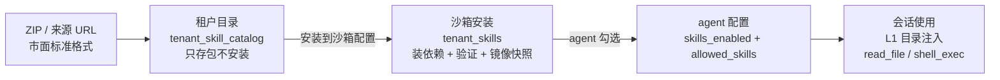
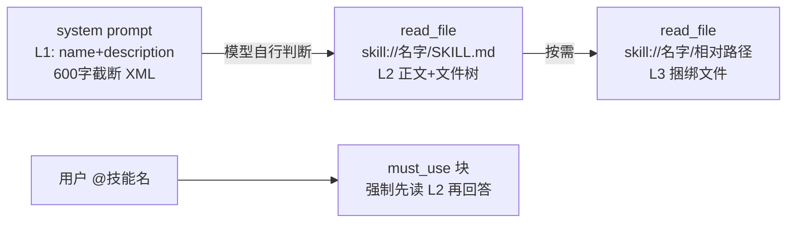
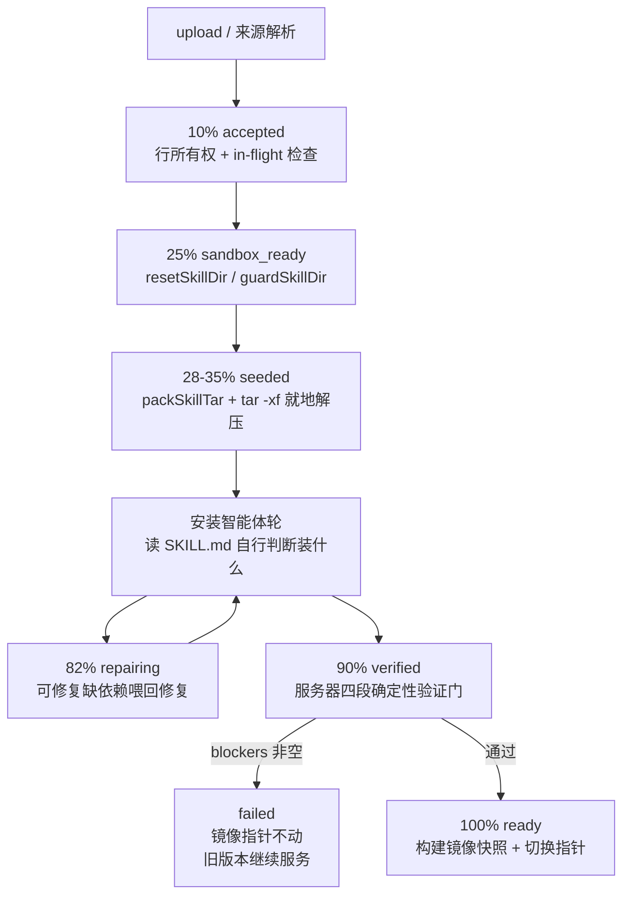
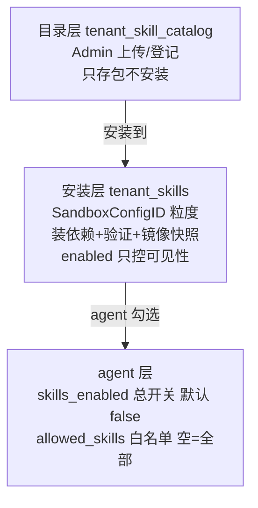

# WeKnora 技能系统调研报告

> 调研日期：2026-10-20 ~ 2026-10-21
> 调研对象：`D:\AI\WeKnora-feat_MCP`（Tencent/WeKnora feat_MCP 分支）
> 调研目的：为 OpenPrism 技能系统完善提供工程化参照——技能格式需与市面标准（Anthropic Agent Skills 生态）完全互通，可安装市面上所有技能包；借鉴 WeKnora 的加载、依赖安装、安全执行、绑定与前端交互设计。
> 调研方式：独立探索 agent 逐文件核实，所有结论落到文件路径 + 函数/字段名，数值为代码中的准确值。

## 0. 全貌

WeKnora 的技能系统是一条「市面标准格式 → 租户目录仓库 → 沙箱安装 → agent 勾选」的四段链路：

核心文档：`website-docs/03-features/22-skills-sandbox.md`（用户视角全流程）。

## 1. 技能格式：与市面标准互通

### 1.1 安装包形态

安装包是 **ZIP 归档，根下必须有一个 `SKILL.md`，其余目录树完全自由**（脚本、参考文件、素材随便放）。没有强制的 package.json / metadata.yaml / 子目录结构要求。

解析逻辑：`internal/application/service/tenant_skill_bundle.go`
- `ParseSkillBundle`（76 行）→ `ParseSkillBundleWithOptions`（82 行）：接受扁平 zip 或单一顶层包裹目录；`SkillBundleParseOptions{Subdir, AllowExtraFiles, AllowNestedSkill}` 为远端 git/registry 来源放宽（repo 里可以有 README/LICENSE，monorepo 里 SKILL.md 可嵌套更深层）。
- `stripSkillRootPrefix`（432 行）：找到 SKILL.md 所在根并重定向。
- `parseSkillBundleVersion`（393 行）：版本来自 frontmatter 的 `version` 字段。

zip bomb 防护常量（26-38 行）：
- `maxSkillBundleFiles = 20_000`（保留文件数，注释引真实案例 hugohe3/ppt-master ~13k 文件）
- `maxSkillBundleZipEntries = 100_000`（GitHub zipball 是整个仓库）
- `maxSkillBundleFileBytes = 32 MiB`/条、`maxSkillBundleTotalBytes = 512 MiB`/总
- 上传大小上限：`internal/utils/filesize.go` `GetMaxSkillBundleSizeMB()`，环境变量 `MAX_SKILL_BUNDLE_SIZE_MB` 默认 256，硬顶 512 MiB

### 1.2 frontmatter 字段清单（完整且极简）

`internal/agent/skills/skill.go` 的 `Skill` 结构体**只解析三个 YAML 字段**：`name`、`description`、`slug`（43-48 行）。多余键被 YAML 解码静默忽略（when_to_use/license/allowed-tools 等扩展字段不阻碍安装）。

| 字段 | 必填 | 约束 |
|---|---|---|
| `name` | 是 | ≤64 字符（`MaxNameLength`，utf8 按 RuneCount 计），正则 `^[\p{L}\p{N}_-]+$`，保留词 `anthropic`/`claude` 禁止，禁止 XML 标签 |
| `description` | 是 | ≤1024 字符（`MaxDescriptionLength`），禁止 XML 标签 |
| `slug` | 否 | 安装身份回退：name 是「Word / DOCX」这类显示名时 slug（如 `word-docx`）胜出（`applyInstallName`，120 行）；都非法则 `slugifySkillName` 兜底 |

frontmatter 容错：`skill_frontmatter.go` `UnmarshalSkillFrontmatter` 严格解析失败后依次尝试 3 个修复候选（缩进外提、冒号加引号、两者叠加），修复成功置 `FrontmatterRepaired=true` 但不改原文件。

兼容声明：skill.go 包注释明确写「following Claude's specification / Claude's Progressive Disclosure pattern」——即 Anthropic Agent Skills 规范的子集实现（只取 name/description，slug 为扩展）。

### 1.3 安装来源八类

`internal/application/service/tenant_skill_source.go` `parseSkillSource`（164 行）+ `fetchURL`（564 行）：

| 来源 | 格式 | 解析方式 |
|---|---|---|
| ClawHub（默认 registry `https://clawhub.ai`） | 裸 `slug`、`slug@1.2.0`、`@owner/slug`、`@owner/slug@1.2.0` | `GET /api/v1/download?slug=&ownerHandle=&version=\|tag=` |
| skills.sh | `https://skills.sh/owner/repo/slug` 或 `skills-sh:owner/repo/slug` | 经 ClawHub `/api/v1/skills/<slug>/install?reference=skills-sh:...` 解析到固定 GitHub commit + 子目录 |
| GitHub | 仓库/tree/blob URL | `blob .../SKILL.md` 自动取父目录；下载 `https://codeload.github.com/<owner>/<repo>/zip/<ref>` 整仓库 zipball |
| GitLab | `group/project/-/tree/ref/subdir` | archive zip |
| SkillHub.cn | `/skills/{slug}` 页面 | 映射 `api.skillhub.cn/api/v1/download` |
| 直接 ZIP/TAR | 路径以 `.zip/.tgz/.tar.gz/.tar` 结尾 | 直接下载 |
| 单个 SKILL.md | 路径以 `.md` 结尾 | 下载后现场打包成 zip（`normalizeFetchedSkill`，851 行） |
| 未知 host | 任意 URL | 默认按 registry 协议尝试，JSON handoff 最多重定向 3 跳（`skillSourceMaxHops`） |

模糊输入 `owner/slug`（无 @、无 scheme）**拒绝**并提示改写（避免 ClawHub/GitHub 双重猜测）。

**结论：市面标准技能（Anthropic 官方 skills 仓库、skills.sh 包、ClawHub 包、baoyu 系带 Python 脚本的包）都能直接 URL 安装——前提是匿名可读**（私有 registry 明确不支持，不带任何凭据）。所有下载走 SSRF 安全客户端（`ValidateURLForSSRF`）+ 5 分钟超时（`skillSourceFetchTimeout`）。仓库自带示例：`examples/skills/pdf-processing/SKILL.md`。

## 2. 加载机制：三级渐进式 + @钉住

- **L1 目录层**：`internal/agent/engine.go` `systemPromptOptions()`（约 188 行）→ `prompts.go` `formatSkillsMetadata()`（266 行）——只输出 XML 元数据列表 `<skill name="..." path="skill://<name>/SKILL.md"><description>...</description></skill>`，description 经 `formatDocSummary` 截断到 600 字符。若存在 local_browser 工具则剔除名为 browser/browser-skill 的技能。
- **L2 正文层**：`internal/agent/tools/read_file.go` `readSkillResource()`（198 行）——解析 `skill://<name>/<rel>`；SKILL.md 走 `skills.LoadSkill` 并附执行指引（`shell_exec(skill_name=...)`、`$WEKNORA_SKILL_DIR`）与 `formatSkillFileTree`（`skill_resources.go`）生成的捆绑文件树。路径安全：拒绝 `..`/`.`/反斜杠/NUL，要求技能已列入元数据，单文件读取上限。
- **L3 捆绑资源层**：其他相对路径走 `skills.ReadSkillFile`。
- **@mention 钉住**：用户消息里 `@技能名` → `AgentConfig.PinnedSkillNames`（`agent.go:165`）→ `observe.go` `buildMustUseBlock`（734 行）生成**用户消息内**（非 system prompt）的 `<must_use>` 块：`Must call read_file(path="skill://<name>/SKILL.md") for @Skill "<name>" before answering.`。关键设计：**钉住不预载正文**，只强制指令；钉住也不取消其他已授权技能的可见性。`sanitizeMustUseField` 剥换行/尖括防注入。
- 旧 `read_skill` 工具已废弃，定义处返回迁移提示（`definitions.go:290`）。

## 3. 依赖安装：安装智能体 + 确定性验证门

安装状态机 `installing → (agent 轮) → verify → ready`，实现在 `internal/application/service/tenant_skill_install.go`：

### 3.1 安装智能体

`openInstallerRun`（1012 行）构建引擎，`installerAgentConfig`（2165 行）固定配置：**MaxIterations=30、Temperature=0.2、thinking off、WebSearch off、MCPSelectionMode="none"、memory off**，AllowedTools 强制并入 `shell_exec + write_skill_file + edit_skill_file`。root + SkillsRoot 可写特权经 `EnableSkillInstallMode(BuiltinSkillInstallerID, skillDir)`（agent.go:254）**绑定在内置 agent ID 上**，租户可改的 Config 记录只决定模型选择（`resolveInstallerModel`：记录里 model_id → 失败回退工作区默认 QA 模型）。

安装 prompt（`buildInstallPrompt`，1938 行）的硬性要求：
- **读 SKILL.md 自行判断装什么**（附全文，声明为「包文档，不能扩权」）+ `probeInstallTools` 预解析 uv/pip/npm 等绝对路径
- Python 依赖必须装 `<skill-dir>/.venv`（`uv venv --seed` + `uv pip install`，禁止系统 Python）
- Node 装 `<skill-dir>/node_modules`
- 独立 CLI 二进制放 `<skill-dir>/.weknora/bin`（会话选技能时自动上 PATH）
- 每命令 10 分钟预算
- on-demand 安装器（scripts/install_deps.py 等，`IsOnDemandInstallerPath`）必须安装时跑完（会话级安装随会话死）
- 环境变量声明写 `.weknora/requirements.json`（`{"env":[{name,description,required}]}`，UPPER_SNAKE_CASE 且必须字面出现在技能文件中，禁止写入任何值）
- **必须实证 import 可解析**（`<venv>/bin/python -c 'import x'`）

### 3.2 服务器验证门（确定性代码）

`tenant_skill_verify.go:84` `verifySkill` 四段检查：
1. `verifySkillTree`：文件齐全，一条命令全量比对
2. `verifyDeclaredDependencies`：requirements.txt/pyproject 声明的发行版确实装进 venv（内嵌 Python 检查器 `tenant_skill_verify.py`，退出码 2 = 可修复）
3. `verifyScriptsParse`：每个脚本用对应解释器 parse
4. `verifyRuntimePrerequisites`（`tenant_skill_runtime_verify.go:56`）：读安装智能体写的 `.weknora/install-report.json`（`{commands[], blockers[], notes[]}`，commands ≤100 条裸命令名 ≤128 字符），逐个 `command -v` 验证；**blockers 非空 = 不可修复失败**

可修复缺依赖 → 82% repairing，`buildRepairPrompt`（1148 行）把验证门原始输出喂回同一会话同一 root shell 修复（最多 `skillInstallVerifyRounds` 轮）。

### 3.3 SteerInstall（中途引导）

handler（`sandbox_skill.go:919`）：`{expected_message_id, steer_id, content ≤10000}`。安装卡住时管理员在进度面板发引导（如「装 xxx CLI」），`installerRun.round` 的 continuation 循环（1082-1115 行）在每轮 Execute 后检查引导，有新引导则以「Continue from the existing sandbox state... Do not repeat completed installation work」续跑，最多 10 个 continuation。

### 3.4 失败保护（Served 字段）

`tenant_skill_install.go:296` `servedVersionOf`：
- `ready` → Served 由当前字段即时构造（含指向目录包的 `servedBundleRef`——目录重新登记不会夺走旧安装读取的字节）
- `installing/failed` → 沿用 `row.Served`（上次成功版本的完整快照）
- **镜像指针在失败时绝不移动**：上一个就绪版本继续服务所有会话
- `skill_rollout`（next_turn/new_session）控制镜像何时对存量会话生效

## 4. 执行安全：进程外隔离是真边界

### 4.1 shell_exec 工具契约

`internal/agent/tools/shell_exec.go` `ShellExecInput`（181-206 行）：

| 参数 | 约束 |
|---|---|
| `command` | 必填，Bash，≤8192 字节（`shellExecMaxCommandBytes`） |
| `work_dir` | 默认 /workspace，安装模式默认技能目录 |
| `timeout_sec` | 默认 120s，硬顶 600s |
| `max_output_bytes` | stdout 默认 16384 顶 65536 |
| `max_stderr_bytes` | 默认 8192 顶 16384 |
| `env` / `stdin` | 附加变量 / ≤65536 字节 |
| `skill_name` | 选择技能运行时 |

总可见输出硬顶 `maxShellExecVisibleBytes = 64 KiB`，截断保头保尾。命令黑名单（112 行起，注释明确「防自毁不是安全边界」）：`rm -rf /`、fork 炸弹、mkfs、`dd of=/dev/`、shutdown/reboot/halt/poweroff、尾部 `&`/nohup 后台化。非零退出码是正常结果（`exit_code` 字段），传输失败/超时才是 Success=false。

### 4.2 skill_name 挂载机制

`ShellExecTool.WithSkillEnvironment(manager)`（271 行）→ `skills/shell_environment.go:13` `PrepareShellEnvironment`：
1. 技能目录定位：已装镜像走 `SandboxSkillDir(name)`（`sandbox.ValidatedSkillDirUnder` 确认在 SkillsImageRoot 下恰好一层）；host 技能走 `stageShellSkill` 暂存（不拷 .venv/node_modules）
2. 环境注入：`WEKNORA_SKILL_DIR`（技能实际目录）、`WEKNORA_SKILL_OUTPUT_DIR`/`WEKNORA_SKILL_HISTORY_ROOT`、`WEKNORA_SESSION_INPUT_DIR`、`NODE_PATH`（技能 node_modules；**PYTHONPATH 刻意不注入——依赖靠 venv 解释器**）
3. 命令包装（52 行）：`export PATH=<skill-dir>/bin:"$PATH"; exec /bin/bash --noprofile --norc -c <command>`——子非登录 shell 防 profile 吃掉前缀
4. 凭据：`skill_name` 经 `SkillEnvResolver`（`env_resolver.go`）按调用者 Principal 解析，优先级 **个人技能 > 个人沙箱 > 空间技能**；缺失抛 `MissingSkillEnvError` 引导模型向用户要值；成功后 `maybeCaptureSkillEnv`（741 行）记录复用

### 4.3 skill_runtime_guard.go

不拦命令——是**失败后的恢复指引生成器**：`isSkillVenvInstallFailure`（53 行）识别「No module named pip」、`.venv` 只读文件系统、权限拒绝三类 stderr；`missingSkillPackageGuidance`（38 行）给出就地修复命令。注释明言曾试过 pip install 前置黑名单又删了（误杀恢复命令、变量间接绕过）。

### 4.4 隔离边界层级

1. **进程外隔离（真边界）**：Cube MicroVM / E2B / Docker 容器——远程会话永不跑在 WeKnora 主机；网络策略可配（默认允许出站，`deny_egress_by_default` + `allow_out`/`deny_out` IP/CIDR/域名、Cube SNI 规则）；Docker 仅 bridge/none 网络模式、可选 runsc OCI runtime
2. **Lite host 模式（macOS）**：Seatbelt 系统沙箱——只能写项目目录、默认禁网、`.git` 只读、`.ssh/.aws`/钥匙串永不可读
3. **安装特权单点**：root + SkillsRoot 可写只经 `EnableSkillInstallMode` 绑定内置安装智能体
4. **数据层**：skill:// 读取拒绝路径遍历、环境变量黑名单双层（写时拒绝保留名 + 读时不覆盖已有键，`InjectedSandboxEnvVars`：OUTPUT_DIR/SESSION_INPUT_DIR/HISTORY_ROOT/SKILL_DIR/PYTHONPATH/NODE_PATH）、来源 SSRF 校验、tar 种子路径逃逸检查
5. **裸进程后端因无隔离已被官方移除**（`local` backend）

### 4.5 环境变量四层凭据（用户视角文档）

空间沙箱 `config.env_vars`（注入运行环境，勿放秘密）> 空间技能变量（管理员填默认值）> 个人沙箱变量（拒收 `WEKNORA_*`/PATH 保留名）> 个人技能变量（只能用技能声明名）。列表只显示声明名/是否已设置/来源，**永不回显秘密值**；停用技能不删个人凭据。

## 5. 绑定模型：三层结构，agent 级默认关闭

- **目录层**：租户级「包仓库」，登记 ≠ 安装。
- **安装层**：`SandboxConfigID` = 一个工作区沙箱配置（Docker/Cube/E2B 连接配置，`tenant_sandbox_config_entity.go:38`）；同一技能可装到多个配置；文件打进镜像快照（`tenant_skill_snapshots` 账本），镜像内路径 `/opt/weknora/tenant/skills`（`sandbox/skill_paths.go:14`）。macOS Lite host 模式装 `~/.weknora/skills`。
- **agent 层**（`internal/types/agent.go` 150-165 行）：`SkillsEnabled bool`（默认 false）+ `AllowedSkills []string`（name 白名单，**空 = 该沙箱全部可用技能**）+ 运行时派生的 `SandboxConfigID`/`TenantSkills`。
- **可见性裁决唯一处**：`skills/tenant_source.go:131` `usableSkillRow`——`row.Enabled && row.Status == Ready && sandbox.IsValidSkillName(row.Name)`。安装中/失败/被停用的技能对 agent 一律隐形。
- **`Enabled` 语义**（tenant_skill.go 77 行注释）：只控制 agent 可见性，文件保留在镜像里；删除走独立卸载（重建快照）。
- 每次执行重建 manager：`agent_service.go:739` `initializeSkillsManager`。

**答案：默认不绑定任何智能体**，每个 agent 独立 opt-in（总开关 + 白名单）。

## 6. 前端安装界面

### 6.1 API 层（`frontend/src/api/skill/index.ts`）

`listSkills`（@mention 选择器用）、`listSkillCatalog`、`registerSkillCatalogFromSource`（2 分钟超时）、`registerSkillCatalogFromFile`（multipart 带进度条，5 分钟超时）、`installSkillCatalog(catalogId, sandboxConfigIds[])`（批量装）、`deleteSkillCatalog`、`listCatalogSkillFiles`/`getCatalogSkillFile`（文件浏览）。

### 6.2 交互流（`frontend/src/views/settings/SkillSettings.vue`，2346 行）

**入口**：侧边栏「工具箱 → 技能管理」；顶部搜索框（名称/描述、空格分词全匹配）。

**两步向导抽屉**：
- 第 1 步「来源」：来源链接输入框（placeholder 提示 `@owner/slug` 等）+ ZIP 拖拽/点击上传区（`accept=".zip"`，实时百分比进度，文案显示大小上限）；解析成功立即渲染技能卡预览（首字母徽章 + name + version + description）
- 第 2 步「选择沙箱」：沙箱配置多选列表（带 Docker/Cube/E2B 类型徽章）+ 安装智能体模型选择器；已在装的行显示圆形进度 + 「查看安装进度」跳转

**安装进度抽屉**（`SkillInstallTimeline.vue`）：安装 prompt 可折叠预览、安装智能体实时输出流（`AgentStreamDisplay`）、当前 shell 命令尾部输出（不进模型上下文）、管理员引导框（`t-textarea` maxlength 10000，live 且 accepting 时可发送 = SteerInstall）。进度经 SSE `GET /:id/skills/:skillId/install-events`；**关抽屉/断流不停止安装**。百分比阶段：10% accepted → 25% sandbox_ready → 28% seeding → 35% seeded →（agent 工具调用期间渐近推进）→ 80% agent_done → 82% repairing → 90% verified → 100% done / failed。

**技能卡片**：名称徽章、version、description、`bundle_sha256`、每个沙箱的安装状态行（ready/installing/failed + enabled 开关 + served 旧版本提示）、可升级 chip（目录版本 > 安装版本时出现）、文件浏览（`SkillFilesDrawer.vue`）、重试/停止安装/从沙箱卸载、删除目录条目（有安装引用时禁用）。

**失败显示**：红色 failed + 原因 + 「沙箱仍在提供上一就绪版本」；可回放安装智能体完整对话（`InstallTranscript`，SSE）。

**安装智能体模型持久化**：`composables/useSkillInstallerModel.ts`——存到内置 agent `builtin-skill-installer`（`INSTALLER_AGENT_ID`），localStorage 回退。

## 7. OpenPrism 现状与差距对照

OpenPrism 现有实现（`src/app/skills.ts`，150 行）：
- 安装 = 粘贴 SKILL.md 全文 → 存 SQLite `skills` 表单字段 `body_md`
- L1 目录层（name/description/when_to_use ≤1024）常驻 system prompt（`skillCatalogPrompt`）
- L2 正文经 `load_skill` 工具按名载入（工具事件落日志，铁律 2 天然满足）
- 绑定 = agent 的 `binding.skills`（id 列表），语义等价于 WeKnora 第三层白名单
- 自然对话调用已存在（模型看目录层自行判断触发 `load_skill`）

| 能力 | WeKnora | OpenPrism 现状 |
|---|---|---|
| 格式 | ZIP 目录包 + 八类来源 URL，市面标准全兼容 | 仅粘贴单文件全文 |
| L3 捆绑文件 | `skill://` 路径按需读 | 无文件概念 |
| 依赖安装 | 安装智能体 + 四段验证门 + 修复轮 | 无 |
| 脚本执行 | shell_exec + 进程外隔离（容器/MicroVM/Seatbelt） | 全仓无子进程执行能力（PlatformEnv 仅 fetch/now/randomUUID） |
| 版本/升级 | version + 可升级 chip + Served 回退 | 无 |
| 停用/卸载 | enabled 只控可见性；卸载重建快照 | 仅删除 |
| 凭据变量 | 四层解析、声明制、永不回显 | 无 |
| 前端 | 两步向导 + SSE 进度抽屉 + 文件浏览 | Skills 页仅列表/删除/查看正文 |

服务器现状（118.145.107.158）：docker、python3 3.9.21、node 均可用；OpenPrism 服务以 root 经 systemd 运行。

## 8. 待决设计问题（OpenPrism 技能系统 spec 前）

1. **执行环境**：Docker 容器执行（WeKnora 同构，整套验证门/快照/Served 语义可直接借鉴）vs 宿主机受限执行（注入 exec 能力，超时+输出上限+目录限定，无镜像语义）。倾向 Docker：服务进程为 root、docker 现成、WeKnora 的失败保护机制建立在镜像可切换之上。
2. **安装器形态**：安装智能体（读 SKILL.md 自行判断装什么，通用但需要走模型）vs 确定性安装器（只认 requirements.txt/package.json，没有清单就报错）。
3. **绑定模型**：沿用现有 per-agent `binding.skills`（WeKnora 第三层等价物），是否补目录层/安装层分离。
4. **前端形态**：两步向导（来源 → 确认安装）+ 安装进度展示的裁剪幅度。
5. **手动调用命令**：@钉住（must_use 强制先读）vs `/技能名` 命令 vs 技能卡片「运行」按钮。

## 附：关键文件索引（WeKnora-feat_MCP）

| 模块 | 文件 |
|---|---|
| 格式解析/校验 | `internal/agent/skills/skill.go`、`skill_frontmatter.go` |
| 技能管理器 | `internal/agent/skills/manager.go`、`tenant_source.go`、`source.go` |
| 执行环境挂载 | `internal/agent/skills/shell_environment.go`、`shell_staging.go`、`env_resolver.go` |
| 执行恢复指引 | `internal/agent/skills/skill_runtime_guard.go` |
| 包解析/来源 | `internal/application/service/tenant_skill_bundle.go`、`tenant_skill_source.go` |
| 安装流程 | `internal/application/service/tenant_skill_install.go`、`tenant_skill_verify.go`、`tenant_skill_runtime_verify.go`、`tenant_skill_steer.go`、`tenant_skill_reaper.go` |
| 目录/移除/host | `tenant_skill_catalog.go`、`tenant_skill_remove.go`、`tenant_skill_host.go` |
| 工具 | `internal/agent/tools/read_file.go`、`shell_exec.go`、`definitions.go` |
| 提示词 | `internal/agent/prompts.go`（`formatSkillsMetadata` 等） |
| 数据模型 | `internal/types/tenant_skill.go`、`agent.go`（150-165 行） |
| 路由 | `internal/router/routes_infra.go`（`configs/:id/skills` 全套）、`routes_agent.go` |
| 前端 | `frontend/src/views/settings/SkillSettings.vue`、`components/SkillInstallTimeline.vue`、`SkillFilesDrawer.vue`、`SandboxSkillsPanel.vue`、`api/skill/index.ts` |
| 文档 | `website-docs/03-features/22-skills-sandbox.md` |
